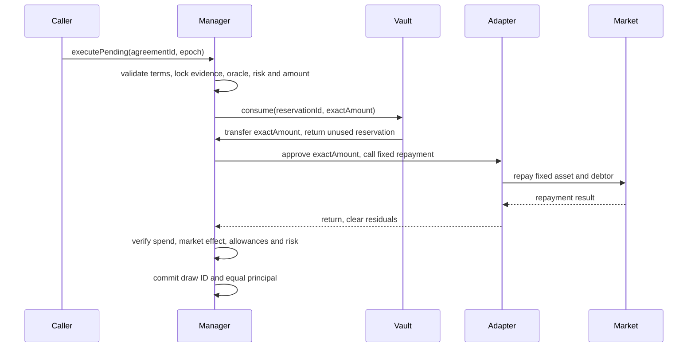
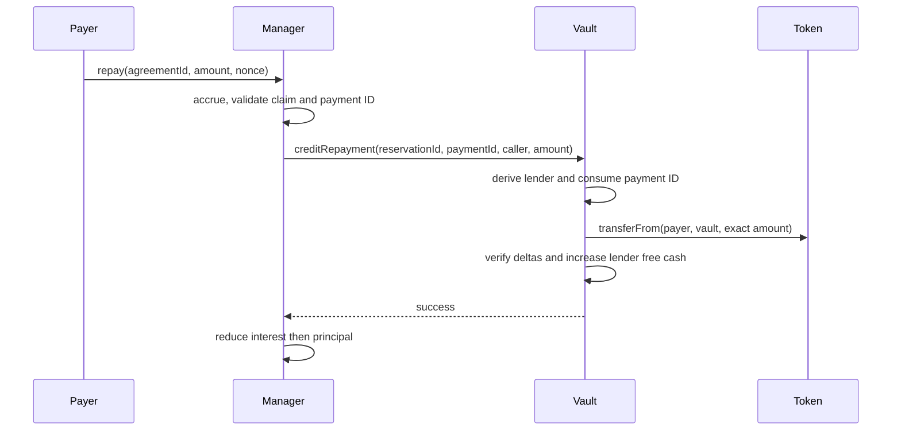

# M2 credit engine preparation

## M2-D local debt servicing

The local manager fixes `APR_BPS = 500` in the manager bytecode bound by the version 3 signature's verifying-contract domain. There is no per-agreement rate field or schema change. `debtPreview(id)` returns outstanding principal, accrued whole-unit interest and total payoff, including one additional unit if fractional carry remains. `accrueInterest(id)` checkpoints a Drawn or Defaulted agreement. `repay(id,amount,paymentNonce)` accrues, rejects zero, overpayment and payer-scoped replay, then calls the vault to pull exactly from `msg.sender` and credit the reservation's original lender. Interest is allocated before principal. Any failed transfer or postcondition reverts the entire transaction. Full settlement closes the local financial agreement without releasing collateral. Anyone may call `markDefault` at or after maturity plus grace; debt and cure remain available.

For fixed 5% APR the exact denominator reduces from `10000 * 365 days` to `630720000` after dividing numerator and denominator by 500. Carry is stored in this reduced denominator. If a repayment extinguishes principal while a fractional carry remains but is one unit short of the full payoff, the carry is crystallized into one whole unit of remaining interest. Principal then accrues no further interest, and the final unit can be paid separately. This preserves the specified final fractional ceiling. EIP-712 version 3 is unchanged.

## M2-C local execution status

The local manager exposes `observeRisk(bytes32)`, `clearRecoveredRisk(bytes32)` and permissionless `executePending(bytes32,bytes32,uint256)`. Version 3 bilateral signatures explicitly bind the exact `autonomousRepayment`, `maxHealth` threshold and local policy ID 1. Risk observation and execution independently read the bound market, and execution rejects any amount other than the signed amount. A recovered or insufficient-debt position permits permissionless pending-operation clearance; a later observation uses a fresh epoch. Successful execution transitions Active to Drawn, records principal and its start timestamp, and returns unused reservation. It checks the bound local market and adapter, collateral fixture, fresh oracle, LTV, debt and exact token balance/allowance postconditions. Failures revert and preserve the pending operation. The local market, oracle and collateral fixtures are controlled by their test operator, and are not production modules or independent proofs. Callback authentication remains a separate future ingress concern. There is no borrower repayment, interest accrual or collateral release path. M1-B live routing and finality remain unverified.

## M2-B local lifecycle implementation

`CreditManager` and `LocalCreditFactory` are local-chain-only lifecycle components. Bilateral EOA EIP-712 signatures and independently controlled borrower and lender nonces authorize a Draft. Each role can invalidate its own unused nonces in any order, including when the same address holds both roles. Registration consumes both atomically. Revocation does not affect a registered agreement or reservation. Activation checks the local collateral and oracle fixtures, then atomically reserves lender-committed liquidity. The borrower can close a Draft or Active agreement, and anyone can expire one at the draw deadline. The fixture's values and assertions are test data, not cross-chain or market evidence. The oracle's local freshness window is one hour. Contract-wallet signatures are not yet supported. Version 3 breaks compatibility with earlier signatures and IDs. [Signing vector](M2_SIGNING_VECTOR.md)

To avoid a circular dependence between the derived agreement and lot IDs, `termsHash` normalizes `lotId` to zero before hashing the EIP-712 `Terms` struct. Signers must sign that normalized typed data. Registration independently requires the supplied lot to equal `keccak256(abi.encode("LOT_V1", collateralChainId, collateralVault, agreementId))`. The fixed manager, vault, asset, adapter and fixture configuration are bound through the EIP-712 manager domain and immutable deployment, rather than repeated as fields in this local struct. This normalization is an implementation decision requiring client and security review before any integration.

Status: M2-B local lifecycle implementation authorized. This document also describes proposed future financial operations. Live Reactive transport, independent finality, external market integration and lender recovery remain unverified.

## Scope and existing boundaries

Base Sepolia is the authoritative ledger for agreements, reservation state, principal and interest. One borrower and lender sign one facility, backed by one identified Unichain ETH lot, with one successful non-revolving draw. The maximum initial and draw LTV is 50%, simple annual interest is 5%, and commitment fees are zero. Draw expiry and maturity are distinct. M2 preparation authorizes no financial activation, ETH release, liquidation or real-value use.

The existing CollateralVault has an immutable binder, accepts one exact-amount lock per agreement, and emits `CollateralLocked(agreementId,positionId,borrower,amount)`. It does not emit a terms hash or operation ID, verify signatures or release ETH. Its lot ID includes the immutable deployment chain ID. The existing LiquidityVault has an immutable manager and consumer, lender-owned `setCommitment`, manager-only `reserve`, `cancel` and `consume`, and returns the unused reservation to free cash on consumption. Its reservation ID is similarly bound to the vault deployment chain ID. These deployments cannot be reconfigured to an independently deployed manager or consumer.

The design below retains `consume` and proposes one measured repayment-credit extension in a new reviewed vault deployment. Existing vaults stay unchanged in this specification milestone. The finality verifier and its governance remain design decisions requiring approval.

## Atomic draw and adapter boundary

Deploy a new vault with both immutable `manager` and `consumer` set to the same CreditManager address. Resolve this constructor dependency with a reviewed deterministic deployment factory and precomputed addresses, and verify both immutable getters after deployment. Existing vault deployments cannot be rewired. Manager and vault must use the same supported, non-rebasing, honest-balance six-decimal asset. The manager is the sole consumer and never exposes arbitrary calls or token withdrawals.

### Immutable deployment sequence

The existing vault constructor is `LiquidityVault(IERC20 asset_, address manager_, address consumer_)`; the local extension preserves it. Proposed manager constructor is `CreditManager(address vault_, address asset_, address localCollateralVerifier_, address localOracle_, address localAdapter_)`. Each dependency is immutable and the local manager exposes no production cross-chain activation endpoint.

A fresh one-shot factory provides the circular addresses without initialization. Predict CREATE addresses for its nonces 1 and 2 using canonical RLP derivation. CREATE the manager first with the predicted vault address, then CREATE the extended vault with the predicted manager as both manager and consumer. The factory must perform no earlier CREATE or CREATE2. The manager constructor validates nonzero parameters but cannot inspect the not-yet-created vault. The factory checks both addresses, runtime code, manager vault/asset/fixture getters, and vault asset/manager/consumer getters before returning. The sequence is one transaction with no user-controlled external calls between creations or checks. Any failure reverts both creations. Retry with a new factory address or fresh CREATE2 salt. Bind a deterministic factory deployment to a designated deployer and parameter commitment to limit address preemption. Pre-funded predicted addresses are surplus, never managed cash. No mutable setter or unrestricted initialization exists. Audit factory nonce assumptions, constructor behavior and front-running before implementation.



The manager holds a reentrancy guard across the entire transaction, marks the draw ID in progress before external calls, and validates the active agreement, pending epoch, deadline, authenticated and independently finalized lock, fresh collateral valuation, reservation owner and balance, signed cap and fixed market/asset/debtor/adapter. The maximum is the minimum of contractual, liquidity, policy, LTV and live market-debt limits. Round down using the market's documented rules. Select an exact spend before `consume`, with a minimum useful repayment. Existing `consume` closes the reservation, transfers that exact amount to the manager, and returns the unconsumed portion to lender free cash in the same call.

Approve only the immutable reviewed adapter for the exact amount, using safe allowance-reset semantics. The adapter is callable only by the manager, approves only the fixed market for the exact amount, executes repayment for the signed debtor and asset, clears market approval and returns. Manager clears adapter approval and verifies both allowances are zero, its own and adapter balances equal their pre-draw baselines, the vault and manager exact deltas, the market debt reduction and actual applied repayment under the market's specified rounding, plus a strictly improved risk measure or full debt exit. Check return-data shape and success, but never accept adapter return values as sufficient evidence. The market and debt accounting source must be trusted, fixed, independently reviewed and protected against upgrade drift. A malicious adapter can lie or interact with a malicious market; measured balances and an untrusted market's self-reported debt do not prove genuine repayment. Pause and reject integrations whose code, accounting, price inputs or upgrade authority fail policy.

Partial market repayment is supported by selecting a smaller exact spend up front. If the market applies less than the amount consumed, refunds tokens, returns malformed or inconsistent values, leaves any new residual or allowance, fails postflight or reenters, revert the entire transaction. This intentionally avoids booking a partial result after the reservation has already closed. The exact successful spend equals new principal, and unused reserved cash becomes free. Interest starts from the committed draw timestamp and accrues only thereafter. A pre-existing unrelated balance is excluded by baseline accounting and cannot be used to satisfy the checks. A fully reverting EVM call tree restores vault buckets, token transfers, approvals, market effects, in-progress ID and emitted logs. This guarantee requires every failure to bubble up as a revert, all economic effects to occur in the same Base transaction, and the token and market to obey EVM transactional semantics. Off-chain side effects or asynchronous settlement are outside this guarantee. After success, the terminal draw ID rejects all duplicates.

## Measured lender repayment credit

Proposed minimal extension to a new reviewed vault version:

```solidity
function creditRepayment(bytes32 reservationId, bytes32 paymentId, address payer, uint256 amount) external;
event RepaymentCredited(bytes32 indexed reservationId, bytes32 indexed paymentId, address indexed lender, address payer, uint256 amount);
```



Only the immutable manager calls this function, guarded by the vault's existing non-reentrancy lock. The vault derives the lender from its stored reservation. Require `Consumed`, nonzero payment ID, nonzero payer and amount, and a globally unused payment ID. The reservation's retained agreement and lender bind the credit to the original facility. No caller supplies a lender or destination. Mark the payment ID consumed before external interaction, pull exactly `amount` from `payer` with `transferFrom`, and verify both payer debit and vault receipt exactly equal `amount`; on any failure revert the ID and all balances. Increase only that lender's `free` and `totalFree` by the measured receipt, emit the event, and leave `reserved` unchanged. Never use pre-existing token surplus as evidence of receipt. Existing withdrawals remain lender-owned.

Manager `repay(bytes32 agreementId,uint256 amount,uint256 paymentNonce)` accrues first, derives a domain-separated payment ID from manager, chain, agreement, payer and nonce, rejects reused IDs, and requires `0 < amount <= current payoff quote`. Overpayment reverts before token transfer. It calls the vault with `payer = msg.sender`, then reduces interest first and principal second by exactly the verified amount, including the final carry rounding unit when fully paid. Any failed call or accounting postcondition rolls back accrual, transfer, lender credit and IDs. The payer approves the vault for the exact amount. Local scope has no relayer flow. A future relayer path requires a payer signature binding agreement, amount, nonce and deadline. No arbitrary-payer path can exploit an old allowance. A fresh payment uses a fresh nonce.

This extension prevents unbacked free cash and lender selection by the manager. It still trusts the immutable manager to authorize a debit from the payer and assign the repayment to a consumed agreement. Code review and payer-bound entry points are required to prevent misuse of token allowances. Token behavior outside the supported asset policy, including malicious `balanceOf`, remains a trust assumption.

Let `F`, `R`, `S` and `B` denote total free, reserved, unsolicited surplus and actual vault token balance. Before and after each successful transition `B = F + R + S`. Let `P` be outstanding principal and `I` payable accrued interest. A payment receipt `x ≤ P + I` changes `B' = B + x`, `F' = F + x`, `R' = R`, `S' = S`, `I' = I - min(x,I)` and `P' = P - max(0,x-I)`. Cash and receivables are separate. A draw of `d` from reservation `r` changes `B' = B-d`, `R' = R-r`, `F' = F+r-d`, and `P' = P+d` after verified market repayment.

For example, a lender begins with 600 USDC free and reserves 500, leaving 100 free and 500 reserved. A verified 200 draw leaves 400 free, zero reserved, 200 principal and 400 vault cash. After 5 USDC interest accrues, a 75 USDC payment credits 75 free, applies 5 interest and 70 principal, and leaves 130 principal and 475 vault cash. A later 130 USDC payment, assuming no further accrual or carry, leaves 605 free, 605 cash and zero principal and interest. A 150 USDC payment while 130 remains reverts without transferring funds. One directly donated USDC remains surplus and does not reduce debt or increase free cash.

## Proposed finalized lock attestation

This is a trusted attestation system for review, not trustless consensus verification. Candidate configuration is 3-of-4 distinct signer keys. Two quorums intersect in at least two signers, so with at most one Byzantine signer and honest non-equivocation for each operation across epochs, conflicting certificates cannot both form. Two equivocating signers can support conflicting quorums, and three compromised signers can certify false source data. Two unavailable signers halt quorum liveness. Independence of operators, keys and nodes is essential; if unavailable for the hackathon, classify the committee as simulated trusted testnet attestation. Reactive remains the autonomous execution mechanism. The finality policy, key custody and operational independence remain unresolved.

Sign an EIP-712 `CollateralLockAttestation` containing schema version, source chain and vault deployment, destination chain and manager/verifier address, agreement ID, lot ID, borrower, amount, canonical event topic and data hash, block number, block hash, transaction hash, log index, transport operation ID and payload hash, finality policy version, signer-set epoch, issue time, expiry and attestation nonce. The EIP-712 domain binds chain ID, verifier and protocol version. Derive the existing vault event's exact fields from a canonical receipt. Bind the immutable terms hash in the signed attestation and require it to match manager-registered terms, while acknowledging the existing event itself contains no terms hash. A quorum assertion about that binding is an additional trust assumption and requires a reviewed bridge from the signed draft to the immutable binder. Record event identity and operation-to-payload mappings independently to prevent the same lot or log being used across agreements.

Each signer must independently verify the receipt and log against a canonical Unichain block and an independently operated rollup/L1 view whose source block has reached the agreed L1-finalized derivation status. Define exactly which RPC/node software, L1 finality criterion, rollup derivation checks, maximum observation age and reorg response apply before activation. An RPC `finalized` tag alone is an operator observation, not an on-chain proof. The verifier enforces unique authorized signers, 3-of-4 threshold, canonical signature encoding, nonexpired statement, epoch and policy, exact agreement/lot/event binding, and matching authenticated transport intent. Conflicting payloads for the same operation or lot are rejected and halt that agreement for manual investigation, never overwritten. If a conflict is discovered after activation, halt new risk and preserve the debt and evidence; do not pretend activation can be rolled back across chains.

An approved governance process must define epoch rotation, timelock, on-chain activation, emergency revocation and independently auditable signer membership. Reject signatures from revoked or retired epochs for new activations, including staged but unapplied statements. Already applied attestations and debts remain recorded. Re-attest pending operations under the new epoch after revocation. A rotation or expiry must not release collateral, cancel debt or free a reserved claim automatically. The issuer of an attestation cannot revoke an already executed transaction. Recovery from finality failure or key compromise needs an incident plan and remains unresolved.

Reactive Omni authenticates a callback through its proxy and injected requesting reactive-contract identity, and its CometBFT finality concerns the Reactive chain. The reviewed documentation does not establish that an origin event received by a reactive contract is independently proven finalized on Unichain, or guarantee delivery, ordering or retry. Both authenticated transport and the separate approved finalized-lock assertion are therefore necessary for financial activation in this proposal. The M1-B live routes have not been verified. [Omni overview](https://dev.reactive.network/) · [Callback authentication](https://dev.reactive.network/callback-contracts)

## Proposed CreditManager interface

All signatures below are conceptual. Exact ABI, type hashes and storage layouts are subject to review.

| Function | Caller and purpose |
|---|---|
| `register(terms, borrowerSignature, lenderSignature)` | Anyone submits two valid, deadline-bound EIP-712 authorizations. Consume both role-specific nonces once and record a Draft. |
| `invalidateBorrowerNonce(nonce)`, `invalidateLenderNonce(nonce)` | The caller invalidates its own unused nonce in the selected role. |
| `stageLockIntent(operation, payload)` | Future authenticated ingress records the exact observed lock intent without granting credit. |
| `submitFinalizedLock(attestation)` | Anyone submits independently verified finalized evidence, bound to the same operation and payload. |
| `activate(agreementId)` | Anyone atomically verifies both facts, fresh valuation and lender commitment, then reserves the full signed cap. |
| `observeRisk(agreementId)` | Anyone asks the approved risk module to sample the bound position. A qualifying observation creates one pending epoch. |
| `executePending(agreementId, epoch)` | Authorized ingress or any local caller performs all live checks and the exact purpose-bound repayment. |
| `repay(agreementId, amount)` | Any payer supplies up to the accrued claim. Exact receipt is applied interest first and principal second. |
| `cancelUnused(agreementId)` | Borrower closes a Draft or Active facility before any successful draw. |
| `expireUnused(agreementId)` | Anyone closes an unused facility at or after its draw deadline. |
| `markDefault(agreementId)` | Anyone records default at or after maturity plus grace if debt remains. Cure remains available. |
| `agreement`, `debtAt`, `pendingOperation` | Read-only state and preview. Preview rounds consistently with state-changing accrual. |

Terms bind version, chain and manager, both vault addresses and deployment chain IDs, borrower and lender, independently chosen role nonces, consent deadline, collateral lot and amount, asset, market, debtor, adapter and policy, cap, maximum 50% LTV, 5% APR, draw deadline, maturity and grace. Verify both signers and role nonces, valid time ordering, supported immutable module configuration, and the lender's separate vault commitment. Contract-wallet signatures require future support. Signed terms cannot be edited by an administrator.

Agreement ID is `keccak256(abi.encode("AGREEMENT_V1", baseChain, manager, borrower, lender, borrowerNonce, termsHash))`. Lot and reservation IDs use their existing vault formulas and deployment chain IDs. A draw ID binds manager, agreement and monotonically increasing risk epoch. Cross-chain operation IDs bind version, source chain, emitter, destination chain, receiver, kind, agreement, sequence and canonical payload hash. Evidence additionally binds canonical block hash, transaction hash and log index. Store operation ID and payload hash together. Exact duplicates are no-ops and conflicting reuse reverts. Consumed nonces, invalidated epochs and terminal agreements never reopen.

## Transitions and atomicity

| Transition | Preconditions and outcome |
|---|---|
| Absent → Draft | Valid bilateral consent and unused nonce. Store immutable terms and emit `AgreementRegistered`. |
| Draft → Active | Matching authenticated transport intent and finalized lock evidence identify the expected vault, lot, borrower and amount. Cap fits current LTV, commitment and free cash. Reserve the cap and emit `AgreementActivated` atomically. |
| Draft/Active → Closed unused | Borrower cancels, or anyone expires at the draw deadline. Invalidate pending epoch and return reservation if present. Emit `AgreementClosed`. No collateral release is enabled. |
| Active → Drawn | A current pending epoch passes all live checks before draw deadline. In one guarded Base transaction consume at most the cap, complete the bound market repayment, verify actual vault debit and market effect, return unused reservation, and book equal principal. Emit `DrawExecuted`. Any failure reverts all local effects. |
| Pending → Invalidated | Close or epoch expiry permanently invalidates that draw ID. A later qualifying observation uses a new epoch. |
| Drawn/Defaulted → same | Accrue and apply measured partial receipt to interest then principal. Emit `DebtRepaid`. |
| Drawn/Defaulted → Closed | Full measured payment clears principal, accrued interest and any final rounding unit. Emit repayment and close events. ETH remains locked in the current vault. |
| Drawn → Defaulted | Anyone acts at maturity plus grace with positive claim. Emit `AgreementDefaulted`. No write-off, seizure or assumed settlement. |

Registration/cancellation recovery for a lock made before registration remains a future release-protocol requirement from the architecture. The current vault cannot enact release or an early tombstone. Cancellation and draw race by Base transaction ordering. If execution wins, unused cancellation fails. If close wins, the epoch is invalid. Failed transfers, failed repayment, stale data and reentrancy revert atomically. Expiry cannot erase debt, and default cannot block cure.

## Valuation, debt and rounding

Normalize prices to the same scale. For ETH wei `W`, ETH/USD price `E` and USDC/USD price `U`, compute `floor(W * E * 10^6 / (10^18 * U))` using full-precision multiplication and division. Feed decimals, positive values, timestamp bounds, heartbeat, sequencer status and grace period must be validated. Do not trust future-dated or stale observations. A Base ETH reference values the economic asset and does not establish Unichain custody or settlement value.

Let `limit = floor(valueUSDC * min(signedLtvBps,5000) / 10000)`. Activation requires cap ≤ limit. On draw, `headroom = max(0, limit - principal - accruedInterest)` and spend is bounded by headroom, remaining contractual cap, reserved cash, current market debt and purpose-policy cap. Require a useful positive repayment and verified risk improvement or complete debt exit, with explicit tested market rounding tolerance.

For each accrual interval use denominator `D = 10000 * 365 days`, numerator `principal * 500 * elapsed + carry`, interest increment `floor(numerator / D)`, and `carry = numerator % D`. Accrue before each principal change with full-precision arithmetic. Do not compound accrued interest. On final payoff, charge one USDC base unit if carry is nonzero and clear it. Define the full-payoff quote and actual receipt in the same transaction to avoid leaving rounding dust. Reject payments above the claim before transfer and allocate valid payments to interest before principal. Interest continues through default until a separately approved settlement policy says otherwise.

Managed vault cash equals free plus reserved. Reservation creates no principal. Principal equals cumulative verified draw minus measured principal repayment, recovery and approved write-off. Recovery and write-off are disabled in this scope. Interest and principal are receivables until actual payment is credited to the correct lender. Unsolicited token and ETH transfers remain segregated surplus. Closing a funded agreement requires zero principal and interest, and closing an unused agreement requires zero reservation.

## Authentication and dependencies

M1-B live callback delivery, injected sender, ordering, redelivery and finality behavior remain unverified. Before any live activation, validate the exact proxy and reactive sender and require an independently authenticated finalized source assertion. The candidate 3-of-4 quorum introduces explicit signer and node trust and is not an approved finality verifier. A raw RPC response or Reactive callback alone cannot satisfy this gate. Duplicate, delayed, missing, contradictory and reorged evidence must fail closed.

An approved oracle needs feed addresses, decimals, heartbeat, sequencer handling, USDC basis policy and manipulation bounds. The market adapter needs a verified asset-compatible market, precise debt and health semantics, bounded approvals and atomic rollback. Aave's observed Base Sepolia test USDC differs from Circle test USDC. A deterministic market and oracle fixture can exercise local mechanics while clearly labelled as such. Real lender recovery needs an independently specified and verified sale or prefunded settlement path and explicit shortfall accounting. There is no liquidation or ETH release in this preparation.

## Test plan

- Unit: bilateral consent, nonce/domain errors, vault consent, reserve accounting, activation guards, deadlines, fixed target, successful and failed draw, partial/full repayment, zero and boundary amounts, interest carry and final-unit rounding.
- Fuzz: full-range collateral and price decimals, overflow-safe valuation, stale/future timestamps, LTV boundaries, cap clipping, interest checkpoint partitions, repayment allocation and nonce/operation domains. Compare to an independent high-precision model.
- Stateful invariants: ghost-ledger free/reserved cash, measured receipts, principal and interest, single successful draw, terminal states, surplus isolation, no cross-agreement effects and no release. Require action coverage and track rejected operations rather than passing through empty handlers.
- Adversarial: duplicate and conflicting evidence, delayed and out-of-order intent/proof, invalid quorum, stale or reorged lock, concurrent draws, reserve exhaustion, deterioration between observation and execution, sequencer outage, forged callbacks, adapter under/over-spend, failed market call, token transfer anomalies and reentrancy.
- Lifecycle races: cancellation or expiry against execution in both orders, repayment against default, partial repayment after default, and repeated payoff. Missing destination evidence never infers success. Mock transport and oracle tests must be labelled local.

## Implementation sequence and acceptance gates

1. Review and approve this specification, particularly lender repayment credit, atomic adapter integration, signature support and collateral-event binding. No M2 contract implementation precedes review.
2. Specify a test-only architecture with deterministic market, oracle and proof inputs, and a deployable manager/vault/consumer wiring plan. Preserve existing contracts until a separately reviewed migration or replacement is authorized.
3. Implement consent, reservation and debt accounting locally, then add the atomic purpose-bound draw and cure paths. Independently validate formulas and all listed tests. Gate all live financial entry points.
4. Complete M1-B live transport verification separately. Validate sender identity, each route, failure visibility, re-request and reconciliation. This establishes transport behavior, not finalized-source proof.
5. Design, implement and review the independent finality verifier and event binding. Test reorg and quorum failures. Financial activation stays disabled until both transport and finality gates pass.
6. Verify the actual oracle and compatible market or conversion route. Prove real lender repayment credit and separately solve cross-chain recovery before any real-value scope is considered.

Acceptance requires passing unit, fuzz, invariant and adversarial suites with the specified accounting properties, an auditable fixture lifecycle, no arbitrary asset destination, and clear evidence that financial activation and collateral release remain disabled. Live transport, oracle, finality and recovery evidence are separate release gates.

## Frozen local implementation and decision register

Upon explicit authorization, the local scope comprises CreditManager, a new vault version with only the repayment-credit extension, immutable deployment factory, local collateral verification and oracle fixtures, deterministic market/adapter fixtures, agreement registration and reservation, one exact atomic draw, principal and simple interest, partial/full repayment, unused cancellation/expiry, default and post-default cure, plus unit, fuzz, invariant and adversarial tests. Live financial activation, production feeds and markets, collateral release, liquidation and real-value origination are excluded. Reactive continues as the future autonomous trigger; local fixture tests do not claim live delivery.

The vault enforces manager-only credit, a consumed reservation, lender derivation from the retained reservation record, unique payment ID and exact payer debit/vault receipt before crediting that lender. Existing `_close` sets amount to zero but retains lender and agreement. The manager enforces caller-as-payer, agreement/reservation correspondence, accrued debt bounds, interest-first allocation and repayment nonce. A dishonest or flawed manager can misuse a standing vault allowance or select another consumed reservation despite the vault's correct lender derivation. Security therefore depends on immutable reviewed manager code, exact entry-point authorization and atomic postconditions; no unrestricted admin may alter the binding. Failed calls revert both contracts and token changes.

Decisions accepted in principle are existing `consume`, manager-as-consumer, exact atomic repayment, measured lender credit, interest-first allocation and overpayment rejection. Outstanding live decisions are independently operated signer membership and 3-of-4 approval, source finality policy, epoch rotation/revocation and emergency authority, live Omni verification, asset/oracle and market/adapter suitability, and lender recovery. The local fixture uses simulated trusted assertions; it does not imply an independent committee is available.

## M2-G arithmetic remediation and local closure

The manager now enforces the reviewed financial operating envelope described in [FINANCIAL_MODEL.md](FINANCIAL_MODEL.md): 1,000,000 USDC maximum commitment and principal, six-decimal asset checked at construction, fixed 5% simple APR, 365-day contractual term from draw deadline to maturity, and checked uint64 timestamp representation. Both timestamp mappings are uint64, and every deadline, oracle freshness check, draw checkpoint and interest checkpoint uses a checked conversion. A backwards timestamp reverts. Interest continues from draw through maturity and default over the entire uint64-representable range; the contractual term is not an accrual cutoff. No saturation, forgiveness or silent truncation was added.

The version 3 signing schema, `TERMS_TYPEHASH`, agreement/lot derivation, domain separator and the deterministic external signing vector are unchanged. Acceptance of the new limits is an additional on-chain validity rule for newly signed terms; no existing signature was modified. The original extreme-value reproduction is now a rejection regression. Boundary tests cover the maximum commitment and principal, one base unit above each limit, the maximum term and one second beyond, invalid and reversed timestamps, maximum elapsed arithmetic, large accumulated interest, repeated checkpoints, fractional carry boundaries, exact payoff rounding, duplicate-rounding prevention, post-default partial and full repayment, failed-registration nonce/liquidity preservation, and unchanged normal-value behavior. See [M2_SECURITY_VERIFICATION.md](M2_SECURITY_VERIFICATION.md) for executed results.

M2 local financial engine status: complete. Reactive integration, live callback authentication, source finality, production oracle and market verification, collateral release and lender recovery remain separate later gates.
