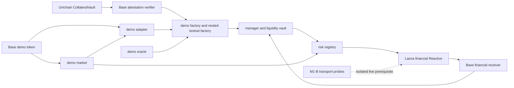

# M4-A deployment readiness (local preparation only)

No network transaction was sent. M1-B live verification, funding, finality policy and operational identities remain open. This package is for testnets and uses a simulated market, oracle and cMOCK, not Circle USDC. No contract releases the locked collateral.

## Dependency graph and ordering

Deploy source vault with approved binder; Base demo token, oracle and market. Obtain the Base deployer nonce immediately before verifier deployment. The demo factory nonce is current nonce + 2 (one verifier, one adapter); `DeployM4.predicted` derives the outer factory, nested factory, manager and vault. Deploy verifier and adapter pinned to predicted manager, then outer factory with no intervening deployer transaction. The nested factory deploys manager and vault atomically. Stop on nonce drift; do not reuse a prediction. Deploy registry, Lasna Reactive, Base receiver; verify all bindings across both networks before Lasna `configure`. Configure itself installs the fixed subscription; there is no separate trigger deployment (`FinancialTrigger` is a library). Fund each provider reserve separately. The isolated M1-B probes are a separate deployment and verification gate; their immutable receivers and reserve balances are not the financial route's.

The script enforces chain IDs, required values, pinned provider addresses, token runtime, address predictions and selected immutable bindings. Cross-chain address code cannot be checked from one chain: run `verifyCollateral`, `verifyBase` and `verifyLasna` separately, check the verifier's four signers, governance, emergency authority and epoch against approved values, and independently inspect system/proxy runtime and source-vault receipt. Post-broadcast checks cannot reverse already mined transactions; reconcile every receipt before continuing. The Solidity script runs locally under Forge; its large size is not a deployed contract. The manifest is a template, not an assertion of deployments. Never put secrets or credentialed RPC URLs in it.

## Costs and transaction inventory

| Network | M1-B transport, separate | Additional financial route | Other obligations |
|---|---|---|---|
| Lasna | 1 Reactive deploy, configure/subscribe, system reserve funding, trials/retries. Historic ceiling 4.5 lREACT includes its proposed 3 lREACT prepaid reserve. | 1 financial Reactive deploy, configure/subscription, reserve deposit, possible retries. Prior local constructor trace 1,238,093 gas; reaction/provider charges unknown. | New gas quote, provider debt, reserve and contingency required. |
| Base Sepolia | 2 emitters and 2 receivers, 2 receiver funding transactions and trials. Historic ceiling 0.004 ETH includes proposed 0.0005 ETH per probe receiver reserve. | 8 top-level deployments: token, oracle, market, verifier, adapter, outer factory (creates nested factory/manager/vault), registry, receiver; 1 separate receiver reserve deposit; token mint/approvals/deposit, register, attestation, activate, market/oracle configuration, signal, repayment and possible retry. | Include transaction execution, OP Stack L1 data and any active operator fee on every applicable transaction; fund borrower/lender signers as needed. |
| Unichain Sepolia | 1 emitter, 1 receiver, receiver reserve deposit and trials. Historic ceiling 0.002 ETH includes proposed 0.0005 ETH receiver reserve. | 1 collateral vault deployment, binder transaction, lock transaction. | Permanently locked **0.001 test ETH** in addition to gas, data/operator charges and contingency. |

Seven M1-B probe contracts total: 1 Lasna, 4 Base, 2 Unichain. Historical optimized financial deployment traces: six Base demo deployments 9,188,999 gas, Base registry 842,951 and receiver 1,135,346 gas; Unichain vault 440,876 gas. These exclude intrinsic gas, L1 data, operator fees and changed-address effects. Historical (not current) spot quotes were 0.006 gwei Base, 0.0015 gwei Unichain and 100 gwei Lasna. No current signer-specific estimation, actual provider overhead, current quotes, balances or safe combined ceilings were obtained. Earlier signer balances and the 0.005 ETH Base funding target were transport-only and do not establish financial-route sufficiency. Paid provider reserves fund later usage: do not add both a full reserve and its funded charges as separate spending; budget replenishment only when charges exceed prepaid reserves. Query current OP fee oracles with synthetic unsigned deployment and call data, simulate with actual addresses, estimate provider failure/retry charges and add explicit contingency before requesting authorization.

## Approval and readiness gates

Approve exact mock-token code and all dependency code/address bindings; lender, borrower, deployer, binder, token authority, market/oracle operators, Reactive operator, governance and emergency authority; four unique attestors and key custody (3-of-4 is not independent if one person controls all keys); source log finality rule and independent block/hash/receipt/log validation; rotation (24-hour delay), revocation/conflict process and pause recovery; financial callback gas and reserve; separate M1-B and financial ceilings, L1/data/operator fees and contingency; permanent 0.001 test ETH lock; final broadcast authorization. None is inferred here. Verify chain IDs and code, balances, signer identity, and estimates immediately before any later deployment. M1-B's three actual routes, retry and authentication must be evidenced first. Authenticated callback delivery does not establish source finality.

## M4-B operating gate

See [operational approvals](M4_OPERATIONAL_APPROVALS.md), [source-finality procedure](SOURCE_FINALITY_RUNBOOK.md), and [funding requirements](M4_FUNDING_REQUIREMENTS.md). The manifest now contains explicit pending approval and route-evidence fields. The offline checker rejects missing fields but does not authenticate approvals or technically prevent a separately invoked deployment script from bypassing it; broadcast remains a separate human decision.
