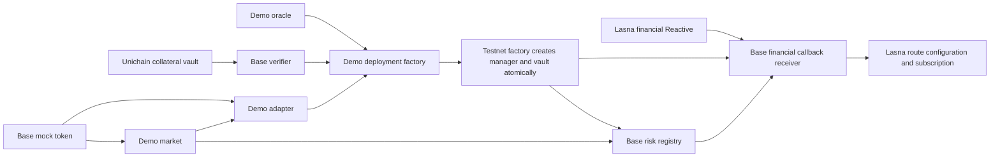

# M4-D financial deployment readiness — conditional, not approved

M1-B core live transport was explicitly approved by the operator. The Stage 4 and Stage 5 manifests remain the evidence; preserve the accepted duplicate reserve and duplicate source deviations, the missing provider request-to-callback links, and the possibility of automatic redelivery. Authentication is not finality, and there is one ordinary live sample per route without independent latency observations. No M4 deployment, financial transaction, reserve deposit or locked collateral is authorized.

## Current source and verification

Revision `2a16fcc18a933d1294cb220d8854e3496cff5a61`: staged/untracked status must be rechecked because frontend development is concurrent. `git diff 84d6ee6..HEAD -- src test script` showed no recorded protocol/test/script change since that M4 checkpoint; later commits include frontend and deployment evidence. This establishes file comparison, not commit provenance. Transport evidence modifications at start: modified `deployments/transport.stage5.pending.json`, modified `docs/TRANSPORT_VERIFICATION.md`, untracked `deployments/transport.stage5.verified.json`; preserve them. No financial Solidity was changed.

`forge fmt --check` passed; `forge build --force --no-cache --out /tmp/covenant-m4-build-out` passed with existing lint/name-collision, timestamp, casts and test-only selfdestruct warnings. `forge test --no-cache --out /tmp/covenant-m4-forge-out -vv`: **203 passed, 0 failed, 0 skipped**, including financial, transport, M3 and integrated suites. Three main invariant handlers each ran 256 runs / 16,384 calls / zero reverts: vault conservation, financial cash/debt ledger and integrated financial callback. Foundry logged invariant discovery warnings and could not write its signature cache under the sandbox; execution still passed. Test count includes 38 integrated tests, 10 isolated transport tests and 8 testnet engine tests. Local fixture testing is not live financial verification.

The implementation includes lock-only `CollateralVault`, accounting `CreditLiquidityVault`, shared `CreditManagerCore`, Base-only `TestnetCreditManager`/factory, 3-of-4 attestation verifier, `DemoToken`, oracle, market, adapter, atomic demo deployment factory, `RiskSignalRegistry`, Lasna `FinancialReactive`, Base `FinancialCallbackReceiver` and `FinancialTrigger` library (no independent deployment). The local-only manager restriction remains. Testnet manager enforces per-agreement max 300e6 cMOCK and per-deployment lifetime principal 300e6; this is not a global deployment-wide allowlist. Demo scenario proposes 200e6 draw, not a universal contract fixed-200 restriction. Bilateral EIP-712 v3 signatures, purpose-bound exact market repayment, atomic principal creation, interest-first servicing and replay controls remain. Attestation is a trusted 3-of-4 committee, not consensus proof. All four attestors are developer-operated, one trust domain. The simulated cMOCK asset/oracle/market are not production financial services; no collateral release or liquidation is implemented.

## Public network snapshot and simulations

Independent latest reads, 2026-11-28 UTC; not atomic block snapshots or a guarantee at broadcast:

| Network | Block / chain | Deployer balance / nonce latest=pending | Lender / borrower native | Gas quote |
|---|---|---|---|---|
| Base Sepolia | 64545926 / 84532 | 0.029817981153616286 ETH / 13 | 0 / 0 ETH | 0.006 gwei |
| Unichain Sepolia | 68978625 / 1301 | 0.009934953020345562 ETH / 4 | 0 / 0 ETH | 0.0015 gwei |
| Reactive Lasna | 9421067 / 5318007 | 3.748439934417 lREACT / 7 | 0 / 0 lREACT | 100 gwei |

Base and Unichain provider proxy runtime hash `0xe9180319ff981b2d5933544a0ae074e451a6e82a7e1da45c1452539e15338f52`; implementation addresses Base `0x49e4ac6954e39c006b0a31955a26a9655c7ce059`, Unichain `0xd00a7f9034337d900e68b20c0da45c3a4f1bf784`, implementation code hash `0x58346a43df5dfbbb297192e5cebf1617cdef9eade8463ae8896d481819649858`. Lasna system proxy runtime hash `0xcd91126ed666997bcf1522fd3f502aea129c440b353b8a8f3aa73636938010ad`, implementation `0xbbbbbbbbbbbbbbbbbbbbbbbbbbbbbbbbbbbbbbbb`, code hash `0x6732df14f3b0b592f99d2aea73414a1905bbb22f4506d814ceabcc374dff0722`. Base/Unichain provider coefficient 1100, extra gas 80000, max charge gas 50000; Lasna 1000/100000/50000. Recheck official configuration, actual code and state at deployment.

Public-signer `eth_estimateGas` with actual constructor bytecode and candidate operator, no signature/broadcast: `CollateralVault(binder)` 445542 gas on Unichain; `DemoToken(authority)` 438493 and `DemoOracle(operator)` 204630 on Base; `FinancialReactive(operator)` 1249086 on Lasna. At the same quote the raw execution components are 0.000000668313 Unichain ETH, 0.000002630958 Base ETH, 0.00000122778 Base ETH, and 0.1249086 lREACT respectively. Synthetic signed-shape fee oracle L1 estimates (with 30% gas-limit buffer and 4m/15m wei caps) were 0.000006993605965205 ETH, 0.000006749076243115 ETH and 0.000003512334552516 ETH respectively; queried operator fee zero. Synthetic signature bytes, fee volatility and actual nonce affect fees, and gas caps do not cap L1 fees. These are isolated estimates; no deployed addresses, receipts or integrated live callback exist.

## Operator approval matrix — candidate roles, not approvals

| Decision | Candidate or proposed rule | Approval |
|---|---|---|
| Deployer, governance, emergency, binder, issuer, oracle/market operator, retry and callback funder | `0xb108b6F40E5Aefdc8475b053BE4248C53eF07B0F`, `covenant-testnet` | Pending |
| Lender / borrower | `0x7345d4b839b6567525268dc89d12301eb86ef6f6` / `0x18cd37C55cDc0F4e948AAaEFC68B23F4a327a295`, distinct | Pending |
| Attestors | deployer plus `0x6F4AE62FeE718db67652500807886052e98eA422`, `0xAc1a3B8c98883e8F1D5e014e547cc0E109Ead4c9`, `0x1243b643C14E8A916f3Cef5474B0E047Af0757A0`; four distinct, 3-of-4; one developer-operated trust domain | Pending |
| Finality and response | successful receipt, exact vault/log/lot, canonical block and finalized tag reconciled across trusted RPCs, destination/epoch binding, expiry <=30 min; 24h rotation; immediate pause, preserve evidence, rotate/reconcile, governance unpause; repayment available | Pending |
| Test-only exposure | 1000 cMOCK lender, 300 commitment/lifetime manager cap, 200 intended draw, 0.001 permanently locked test ETH; 5% simple APR, simulated oracle/market | Pending permanent lock, roles and budget |
| Callback gas, financial reserves, network ceilings, financial broadcast | 1,000,000 gas candidate only; separate financial payer reserves; no real-value assets | Pending measurements and explicit approval |

Operator supplied six verified public keystore addresses; this workflow did not unlock accounts. Attestors do not need gas for off-chain signatures. Lender and borrower need Base ETH for their own transactions; borrower also needs at least 0.001 Unichain ETH plus gas, and receives no collateral release. All three balances are zero; this is a definite funding shortfall. No transfer is authorized.

## Dependency graph, nonce-bound prediction and deployment inventory

`D` is the candidate deployer/operator, `U` is the actual deployed collateral vault, `T/O/M/V/A` the actual mock token/oracle/market/verifier/adapter, `P` the predicted Base manager, `F` the predicted outer factory, `G` registry and `L` financial Reactive. These are distinct from Stage 1–5 transport probe addresses. All constructors sent by `D` use zero value; fund providers separately only under later authorization. `verifyCollateral`, `verifyBase`, `verifyLasna`, `cast code`, runtime hashes, constructor getters and receipts verify each actual deployment; constructor immutables mean compare expected deployed runtime with corresponding immutable substitution, not unlinked generic runtime hash.

| # | Chain and contract / constructor | Dependencies and verification | Gas |
|---|---|---|---|
| 1 | Unichain `CollateralVault(D)` | binder getter; no release | 445542 simulated |
| 2 | Base `DemoToken(D)` | authority and 6 decimals | 438493 simulated |
| 3 | Base `DemoOracle(D)` | operator getter | 204630 simulated |
| 4 | Base `DemoMarket(T,D)` | token exact runtime and asset/operator | 352607 local constructor; actual-dependent |
| 5 | Base verifier `(U,P,D,D,[attestor1..4])` | source vault, predicted manager, governance, emergency, unique signers and epoch | 1961292 local constructor; actual-dependent |
| 6 | Base `DemoAdapter(T,M,P)` | asset/market/predicted manager | 329018 local constructor; actual-dependent |
| 7 | Base `DemoDeploymentFactory(T,V,O,A)` | exact F and P; creates nested factory, manager, vault atomically, verify manager/vault/asset/verifier/oracle/adapter and reciprocal consumer binding | 5910339 local constructor including nested creations; actual-dependent |
| 8 | Base `RiskSignalRegistry(P,M)` | manager, market, adapter binding | 842951 local constructor; actual-dependent |
| 9 | Lasna `FinancialReactive(D)` | system provider/operator | 1249086 simulated |
| 10 | Base `FinancialCallbackReceiver(L,P,G)` | Base proxy, Reactive, manager, registry | 1135346 local constructor; actual-dependent |
| 11 | Lasna `configure(L,G,P,receiver,approvedGas,D)` | exact Base financial registry event, callback receiver and manager; installs subscription | actual-dependent; simulate after dependencies |
| 12 | Lasna and Base `fund(recipient,amount)` | separate new financial system / callback provider reserves | amounts, data and gas pending |

At Base nonce 13 and exactly the indicated Base order, F uses deployer nonce 18: predicted outer `0x7636Ef980CAcf50A85FD0544294A25c9E022a1f6`, nested `0x525d7D8a4856008dbc7C56C2380F5D9cBC3B1bC2`, P `0xF3EB9c4bDD0cB5B538c8B9ccb6b81A7898798E81`, vault `0x87B3E5Ca30C3CCdD6182539Ffff004dbA47F3865`. These are conditional CREATE predictions, not deployed addresses. No intervening Base signer transaction may occur after pinning; recompute before verifier and adapter. The actual factory constructor creates and verifies manager/vault together, but post-broadcast script checks cannot undo an already-mined transaction.

## Financial funding model — provisional, not a ceiling

| Cost component | Evidence / reserve sizing input | Status |
|---|---|---|
| Unichain vault deployment | 445542 gas; synthetic L1 0.000006993605965205 ETH; operator quote zero | isolated simulation |
| Base token, oracle | 438493 / 204630 gas; synthetic L1 0.000006749076243115 / 0.000003512334552516 ETH | isolated simulations |
| Base market, verifier, adapter, outer factory, registry, receiver | local constructor traces 352607, 1961292, 329018, 5910339, 842951, 1135346 gas | intrinsic/rollup fee and actual dependency simulation pending |
| Lasna financial Reactive | 1249086 gas = 0.1249086 lREACT at quote; fees drift | isolated simulation |
| Lasna configure and subscription; deposits on Lasna/Base | actual addresses/gas/value required | pending |
| Financial callback reserves / reactions / failures | 1m gas candidate; provider cost `max(tx.gasprice,basefee)*1.1*(used+80000)` on Base under current settings; Lasna reaction analogous coefficient 1 and 100000 extra | reserve amount and retry count pending |
| Base mint, approvals, deposit, commitment, registration, attestation, activation, signal, repay; operators update market/oracle | L1 data, operator fees, signer/actual state simulations required per transaction | pending |
| Unichain binder + borrower lock | 0.001 ETH principal permanently locked, plus gas, L1 and operator charges | borrower balance zero; gas pending |
| Lender Base / borrower Base | separate gas wallets, zero balance; borrower needs minted mock repayment amount plus actual interest | cannot establish minimum safe allocation until actual transactions/gas |
| Contingency and optional failure/retry | separately priced, include callback reserve draw | pending |

A planning envelope is NOT yet a safe funding ceiling: illustrative **0.005 Base ETH**, **0.002 Unichain ETH including locked collateral**, and **2 lREACT** may be used as discussion placeholders only, not established sufficient. Existing transport reserves are held at the providers for probe contracts and cannot be spent as wallet balances; new financial reserves are separate deposits. Do not add later charges paid from a reserve again as an extra deposit unless budgeting replenishment. Account for distinct account transfers only after approval and include transaction fees. Do not fund based on these placeholders; validate actual dependency simulations, callback gas, fees, operator allocation, retries and contingency first.

## Financial callback gas: blocking measurement

The local successful callback trace used approximately 635819 gas including manager execution, excluding real provider overhead; local tests used a 2000000-gas configuration and a 1000000-gas simulation. The code allows 1000000–3000000 for destination callbacks. Official Reactive documentation gives 100000 minimum callback gas and a **separate 900000 cap on the Lasna reactive transaction**; it gives a 1000000 example, but we have not established a provider-enforced destination upper limit or real financial callback forwarding/billing. Current proxy withholds extra and max-charge gas, so 1000000 is plausible but not live-verified or approved. See https://dev.reactive.network/economy and https://dev.reactive.network/callback-contracts. Do not claim testnet financial callback support until actual-address simulation and authenticated callback measurements.

## Gates

Manifest `deployments/m4.financial-readiness.proposed.json` is deliberately not deployment approved. Run `python3 script/check_m4_manifest.py deployments/m4.financial-readiness.proposed.json plan`; rejection on unresolved attestation policy is expected and is not a valid approved manifest. Remaining gates: role/custody/policy/incident and irreversible collateral approval; current actual-address simulations, L1/operator fees, risk/retry reserve budgets and financial callback gas; lender/borrower funding; verified financial dependency deployment sequence and nonce; final manifest validation and separate financial broadcast authorization. Cross-chain collateral finality relies on trusted RPC observations and 3-of-4 attestors, not an independent consensus proof. The demo keys share one operator trust domain.

## M4-E.2 Stage 2 live deployment

Unichain CollateralVault `0x21AB80a429b48Cc4dFBE35308096930472f56954` was deployed and independently verified; see `deployments/m4e2.stage2.verified.json`. Its approved binder and chain-specific runtime/lot binding match; initial accounting and balance are zero. Stage 2 spent 0.000019890655107390 Unichain ETH and is closed. No collateral was locked. DemoToken and DemoOracle remain the Stage 1 verified addresses. All remaining Base dependencies, callback configuration, funding and activation require separate approval.
